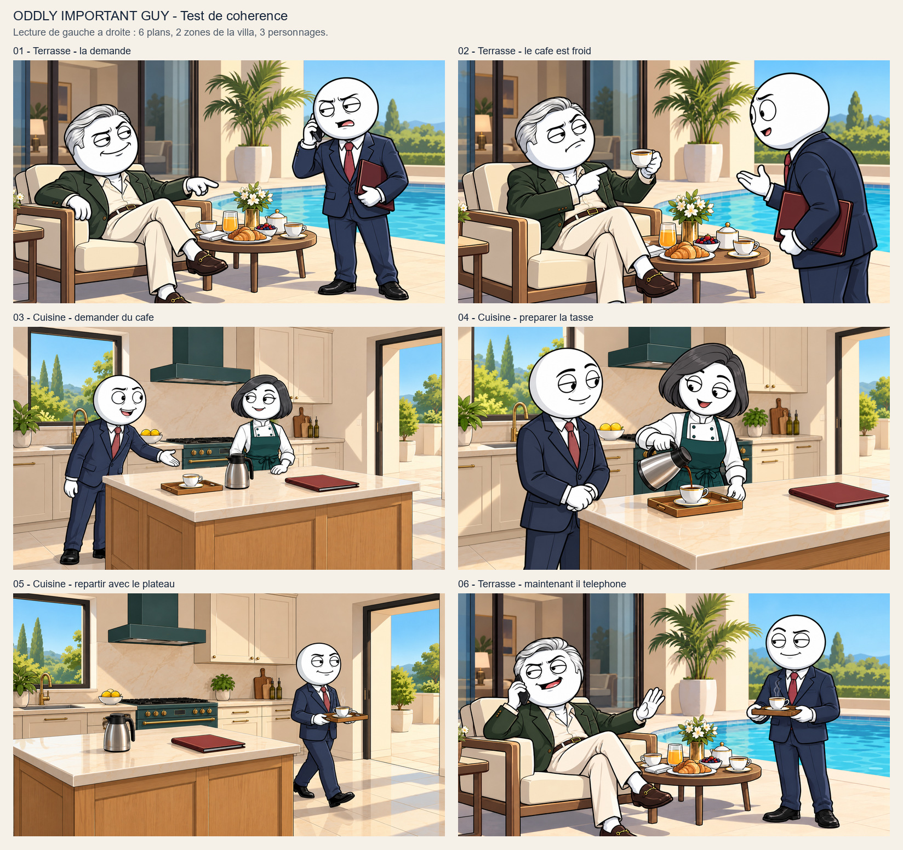

# Oddly Important Guy — essai de continuite et de variete

Demande utilisateur du 18 octobre 2026 : montrer un exemple avant toute production de masse. Six plans fixes, deux zones de la meme villa, trois personnages. Le premier plan reutilise la terrasse deja approuvee ; les cinq suivants sont de nouveaux plans de demonstration. Apres presentation de la planche finale corrigee, l’utilisateur valide la sequence et sa consistance : « Ouais, c’est parfait. Tu geres bien la consistance, c’est propre. » Cette sequence devient une reference approuvee pour Oddly Important Guy ; les limites constatees ci-dessous restent documentees et chaque futur plan reste a inspecter. CLI configure execute sur le VPS, prompts manuels et references choisies par Codex. Aucune voix, synchronisation, video complete ou publication lancee.

## Registre des plans et inspection

La narration ci-dessous est un beat fictif de controle ; aucun temps ou extrait de voix reelle n’est attribue. Le changement de lieu est motive par la demande de cafe, et le retour garde la terrasse initiale. Les vues restent des angles moderes, pas une reconstitution tridimensionnelle exacte.

| Plan | Lieu | Action / etat | Controle visuel |
| --- | --- | --- | --- |
| [01](reference-terrasse.jpg) | terrasse | Image approuvee precedente reutilisee : assistant au telephone, dossier sous le bras, milliardaire assis. | Reference reelle du lieu et des deux personnages ; pas une nouvelle generation. |
| [02](terrasse-demande.jpg) | terrasse | Le milliardaire leve sa tasse froide ; assistant termine son appel et ecoute. | Les portes, le palmier, la piscine et le mobilier gardent leurs relations. Angle lateral surtout visible sur le profil de l’assistant ; changement de perspective modere. |
| [03](cuisine-arrivee.jpg) | cuisine | Assistant a gauche, nouvelle cuisiniere a droite ; dossier pose sur l’ile. | Fenetre/évier a gauche, cuisiniere/hotte au centre, porte a droite retrouves. Sourire de l’assistant plus detendu que la demande pressee du prompt. |
| [04](cuisine-service.jpg) | cuisine | La meme cuisiniere verse le cafe dans la tasse sur le plateau ; assistant attend. | Les deux identites et reperes fixes sont reconnaissables. Plan moyen diagonal, et non une vue inverse ; position du plateau sur le plan de travail legerement reajustee. |
| [05](cuisine-sortie.jpg) | cuisine | Assistant repart seul vers la porte avec le plateau ; dossier reste sur l’ile, cafetiere reposee. | Porte toujours a droite, fenetre a gauche et cuisiniere entre les deux. Vue plus laterale, mais amplitudes et proportions de piece ne sont pas garanties au pixel pres. |
| [06](terrasse-retour.jpg) | terrasse | Assistant revient avec la tasse ; le milliardaire lui fait attendre car il telephone. | Premiere sortie rejetee pour une tasse de table manquante ; correction ciblee inspectee avant livraison. Deux tasses sur table et une sur plateau attendues. Les accessoires secondaires peuvent varier legerement : ce test ne certifie pas un espace 3D reconstruit. |

## References

[Cuisine maitre sans personnages](kitchen-master.jpg), [cuisiniere](chef.jpg). La terrasse deja approuvee sert d’ancre courte pour son lieu et ses deux personnages ; le corps de la mascotte reste celui des essais precedents. Pour un film complet, preparer les references individuelles de chaque recurrent.

La fenetre et l’evier restent a gauche de la cuisine, la hotte et la cuisiniere au centre, la porte de terrasse a droite. La terrasse conserve ses portes vitrees, palmier, fauteuil, table ronde et piscine. Expressions et etats d’objets changent pour les actions ; le dossier reste dans la cuisine apres le depart. Ces constats d’inspection ne prouvent pas une coherence parfaite d’un futur film. Le plan 06 initial perdait une tasse ; sa version corrigee restaure les deux tasses sur table en plus de celle du plateau.

## Prompts manuels et ordre reel des references

Les noms ci-dessous correspondent aux fichiers natifs effectivement envoyes au CLI, dans leur ordre reel ; les exports de ce dossier sont des copies de consultation. Les SHA, fichiers natifs, recus de requete et historique de correction sont conserves dans le travail prive. Les variantes ne remplacent pas silencieusement le maitre.

### 02-terrace-request / scene-v1

Full-frame 16:9 clean narrative cartoon film still, same attractive polished comic drawing as image 1, NOT a thumbnail, collage or storyboard inside the image. Thick confident black contours, controlled matte colours, restrained cel shadows. All humans have large round WHITE cartoon faces and pure white exposed skin and simple white hands; compact adult bodies. Main assistant: bald round head, no nose or ears, navy suit, white shirt, muted red tie, black shoes, exactly the identity in the reference. Distinct supporting characters, never duplicate the assistant. Exactly two arms per person. Expressions and physical actions respond to this beat, not frozen into the reference's face. Readable believable props, attached hands, natural eye lines, no ghost people, no text or logos, no photographic rendering or blur. Preserve the reference art language, but do not transplant its pool or terrace into the kitchen. CONTINUITY: IMAGE 1 is this exact terrace and the exact older billionaire with silver side-part hair, dark-green jacket, open cream shirt, cream trousers, brown loafers. IMAGE 2 is the exact bald assistant. NEXT BEAT: the billionaire has tasted his coffee and finds it cold; he raises ONE of the existing white gold-rimmed cups by its handle to chest height and indicates it with his free hand, mild dissatisfied pursed mouth, looking at assistant. Assistant has ended his phone call; phone now hidden in pocket, burgundy folder tucked under his left arm, free right hand acknowledging with open palm, attentive eyebrows and a polite small open mouth. Exactly these TWO actors, no chef. CAMERA: a genuinely DIFFERENT closer lateral three-quarter angle, shifted along the same terrace TOWARD the glass doors, looking diagonally past the assistant's near shoulder toward the seated billionaire; assistant visible on RIGHT foreground in side profile, billionaire LEFT midground in his SAME chair. Keep their screen sides to retain the conversational axis. The round breakfast table remains directly between their seats, unchanged flowers/croissant/juice/berries/other cup, the selected cup is the one now in the billionaire's hand. The glass door remains behind and left of the billionaire; the single potted palm stands between glazing and pool; blue pool remains to the right. Do not mirror or relocate table, chair, doors or palm. No new skyline or pavilion, no bald billionaire, no folder in owner's hand. Framing shows changed camera perspective and useful acting, not a digital crop of image 1.

References :

1. 01-billionaire/scene-v1.png — Inspected approved terrace scene: drawing, exact billionaire identity, architecture and furniture anchor. Pose and expression may change.

2. identity/hero-v1.png — Inspected main actor identity and navy suit/red tie; compact adult proportions. Expression is adaptable.

### 03-kitchen-arrival / scene-v1

Full-frame landscape 16:9 narrative cartoon still, NOT a thumbnail collage. Match the clean confident black contours, controlled colours and restrained cel shading of the references. MAIN ACTOR in image 2: compact adult bald perfectly round pure-white head, no ears or nose, navy suit, white shirt, muted-red tie, black shoes. All human faces/skin/hands pure white, simple rounded hands, no realistic skin or tiny children. Every actor once only with two arms, no detached props, no ghost duplicate. No captions, text, logos or watermarks. Room geometry comes from IMAGE 1, which must remain the same kitchen, not a redesign or a mirrored layout. Window and sink on LEFT of back wall, dark-teal stove and rectangular hood in CENTRE, cream upper cupboards RIGHT of hood, terrace doorway FAR RIGHT. Oak rectangular island and cream stone top in foreground. Lemon bowl on back counter left of stove, small plants and chopping board remain at their reference locations. Warm daytime light, no extra windows or kitchen islands. Burgundy folder, silver coffee pot with black lid/handle and wooden tray with ONE white gold-rimmed cup and saucer are portable objects, not duplicate props. IMAGE 3 is the exact woman chef, not another version of the assistant. BEAT: assistant has walked inside and put his closed burgundy folder flat on the RIGHT side of the island, as in image 1, freeing his hands. He stands at the LEFT end of the island, full adult body visible, leaning forward just slightly and pointing his right open white hand toward the coffee tray, with a slightly rushed polite open-mouth request. Chef is on the RIGHT behind the island, hand resting beside the silver coffee pot, looking at him with amused raised brow and a small knowing smile. Exactly TWO adults. Camera eye-level wider establishing view from the same entrance-facing side as the master, offset a little left: show the window/sink left, stove centre and open terrace door right so the viewer understands the new room. Keep objects as in master, only actors added. This is a working kitchen interaction, no pool, billionaire or outdoor furniture inside. Main actor is on LEFT here, unlike the previous terrace scene. No phone in either hand.

References :

1. kitchen-master/master-v1.png — Inspected kitchen drawing and geometry MASTER. Keep window/sink left, teal stove/hood centre, cream cupboards and terrace door right. Move only the specified portable objects.

2. identity/hero-v1.png — Exact adult assistant identity, navy suit, muted red tie, bald round white head. Adapt face to action.

3. chef/chef-v1.png — Exact recurring adult woman chef: round white face, charcoal bob, white chef jacket and dark-teal apron, charcoal trousers. Adapt acting.

### 04-kitchen-pour / scene-v1

Full-frame landscape 16:9 narrative cartoon still, NOT a thumbnail collage. Match the clean confident black contours, controlled colours and restrained cel shading of the references. MAIN ACTOR in image 2: compact adult bald perfectly round pure-white head, no ears or nose, navy suit, white shirt, muted-red tie, black shoes. All human faces/skin/hands pure white, simple rounded hands, no realistic skin or tiny children. Every actor once only with two arms, no detached props, no ghost duplicate. No captions, text, logos or watermarks. Room geometry comes from IMAGE 1, which must remain the same kitchen, not a redesign or a mirrored layout. Window and sink on LEFT of back wall, dark-teal stove and rectangular hood in CENTRE, cream upper cupboards RIGHT of hood, terrace doorway FAR RIGHT. Oak rectangular island and cream stone top in foreground. Lemon bowl on back counter left of stove, small plants and chopping board remain at their reference locations. Warm daytime light, no extra windows or kitchen islands. Burgundy folder, silver coffee pot with black lid/handle and wooden tray with ONE white gold-rimmed cup and saucer are portable objects, not duplicate props. IMAGE 3 is the identical woman chef. NEXT BEAT in SAME kitchen: chef calmly pours fresh coffee from the SAME silver thermal pot into the ONE white gold-rim cup standing on its saucer on the wooden tray at LEFT end of island. Chef stands behind the island on RIGHT side of frame, grey bob and dark-teal apron, friendly reassuring small open-mouth smile; one white hand grips the coffee-pot handle, the other steadies the tray edge, a short plausible stream reaches the cup without floating or spilling. Assistant at LEFT, three-quarter side profile, watching the pour, shoulders relaxed and visibly relieved small smile, two empty hands resting together at waist level. Exactly TWO people, not a demonstration cutout. CAMERA: medium shot, view shifted toward the island's LEFT end and slightly closer at chest height, shallow diagonal view across countertop. This is a real lateral perspective change, NOT a zoomed copy. The teal stove and hood still sit behind the centre-left of the pair, cream cupboards behind chef; the left window may be partially cropped. Open terrace doorway remains at far right in background if in frame, never moved left. Burgundy folder remains lying closed at the island's RIGHT end away from tray, visible only if frame includes that area. Do not add a second pot/cup/tray or floating hand. Maintain character scale and drawing.

References :

1. kitchen-master/master-v1.png — Inspected kitchen drawing and geometry MASTER. Keep window/sink left, teal stove/hood centre, cream cupboards and terrace door right. Move only the specified portable objects.

2. identity/hero-v1.png — Exact adult assistant identity, navy suit, muted red tie, bald round white head. Adapt face to action.

3. chef/chef-v1.png — Exact recurring adult woman chef: round white face, charcoal bob, white chef jacket and dark-teal apron, charcoal trousers. Adapt acting.

### 05-kitchen-exit / scene-v1

Full-frame landscape 16:9 narrative cartoon still, NOT a thumbnail collage. Match the clean confident black contours, controlled colours and restrained cel shading of the references. MAIN ACTOR in image 2: compact adult bald perfectly round pure-white head, no ears or nose, navy suit, white shirt, muted-red tie, black shoes. All human faces/skin/hands pure white, simple rounded hands, no realistic skin or tiny children. Every actor once only with two arms, no detached props, no ghost duplicate. No captions, text, logos or watermarks. Room geometry comes from IMAGE 1, which must remain the same kitchen, not a redesign or a mirrored layout. Window and sink on LEFT of back wall, dark-teal stove and rectangular hood in CENTRE, cream upper cupboards RIGHT of hood, terrace doorway FAR RIGHT. Oak rectangular island and cream stone top in foreground. Lemon bowl on back counter left of stove, small plants and chopping board remain at their reference locations. Warm daytime light, no extra windows or kitchen islands. Burgundy folder, silver coffee pot with black lid/handle and wooden tray with ONE white gold-rimmed cup and saucer are portable objects, not duplicate props. NEXT BEAT: coffee is ready. Exactly ONE visible person: the same assistant, full compact adult body, walking toward the FAR RIGHT kitchen doorway that leads back to terrace. He carries the SAME small rectangular honey-oak tray with BOTH white hands visibly supporting it from underneath, ONE white gold-rimmed cup on saucer on tray, a little steam, no plate cover or extra food. Calm small satisfied smile and focused eyes directed at doorway. His phone is in pocket, no folder under his arm. Burgundy folder remains flat on island RIGHT end where he left it; silver thermal pot returned upright at island centre, no duplicate tray or cup left on island. Chef is offscreen behind camera, do NOT invent a second doorway or erase/rearrange kitchen. CAMERA: wider SIDE view from the LEFT short end of the island toward the existing RIGHT doorway. The long oak island stretches from left foreground toward middle distance; its cream top is visible and folder identifiable. The fixed teal stove/hood and cream cabinetry recede along the SAME back wall to the left of the right doorway. Window on the left back wall may be outside this side view, do not relocate it. Bright terrace landing beyond same dark doorway frame. No exterior pool inside room, no new stairs, no copied master camera, no mirroring. The character moves through the room naturally; do not elongate limbs or let tray float.

References :

1. kitchen-master/master-v1.png — Inspected kitchen drawing and geometry MASTER. Keep window/sink left, teal stove/hood centre, cream cupboards and terrace door right. Move only the specified portable objects.

2. identity/hero-v1.png — Exact adult assistant identity, navy suit, muted red tie, bald round white head. Adapt face to action.

### 06-terrace-return / scene-v1 — sortie ecartee pour tasse manquante

Full-frame 16:9 clean narrative cartoon film still in the exact drawing of IMAGE 1, not a thumbnail collage. Thick confident black contours, controlled matte colours, simple cel shadows, round white faces, pure-white skin and hands, compact clothed adult bodies, no realistic face, no duplicated protagonist, no text/logos. IMAGE 1 is the TERRACE MASTER and older billionaire identity; IMAGE 2 is assistant identity; IMAGE 3 is the immediately preceding action and tray/cup reference ONLY, do not transplant the kitchen outside. FINAL BEAT: assistant is BACK on the original villa terrace, standing RIGHT near the round breakfast table, supporting with BOTH white hands from UNDERNEATH the SAME small honey-oak rectangular tray with ONE steaming white gold-rim cup on its saucer. He has no burgundy folder (it was left in the kitchen), no phone in his hands. He looks toward boss with a small patient closed-mouth smile and slightly raised eyebrows, waiting. Boss remains seated LEFT in his original cream armchair, same silver side-part hair, dark-green jacket, cream trousers and brown loafers. Boss is now distracted by his OWN black smartphone held against his ear, looking off left with a confident conversational smile, free hand lifted palm toward assistant as a casual 'one moment'. Exactly TWO adults; one copy of each, two arms each; no chef. The original cold cup has been placed back on the breakfast table, not still in boss's hand. Original flowers vase, croissant plate, juice glass, sugar bowl and berries retain their relative places on that SAME round table. The additional fresh cup stays ON the assistant's wooden tray, not duplicated on table. REAL camera variation: eye-level medium-wide three-quarter view from a position about one metre nearer the POOL SIDE of the original view, looking shallowly back toward glass doors. Retain billionaire LEFT and assistant RIGHT to preserve conversation axis, no sudden reverse or mirrored image. Glass doors remain BEHIND billionaire on left, single potted palm remains to their right between glazing and pool, blue pool remains beyond right of group, cream paving unchanged. The room is recognizable from actual relationships, not a newly invented villa, no marble walls replacing glazing, no new pool shape, no distant buildings. Full useful acting, readable attached hands and stable same adult proportions. This is the comic consequence of the cold-coffee request, with changed expressions and prop states, not another identical tableau.

References :

1. 01-billionaire/scene-v1.png — Inspected approved terrace MASTER: exact billionaire, glass doors, cream chair, round breakfast table, potted palm, pool. Adapt pose and expression only.

2. identity/hero-v1.png — Exact compact adult assistant in navy suit and muted-red tie, bald perfectly round pure-white face.

3. 05-kitchen-exit/scene-v1.png — Inspected preceding beat: assistant carries this wooden tray and one cup/saucer with BOTH hands. Carry these props back outside, NOT this kitchen geometry.

### 06-terrace-return / scene-v2

Make a precise SMALL CONTINUITY EDIT to IMAGE 1, the final shot of our six-frame comic narrative. Preserve the exact entire image 1 composition, camera perspective, ALL faces, actor identities, expressions, poses, attached hands, navy/red assistant costume, green/cream billionaire costume, phone, wooden tray, white gold-rim cup ON THE TRAY, pool, doors, palm, paving, chairs and lighting. Do NOT recreate image 2's actor poses or phone call: image 2 is only the original breakfast-table prop reference. The one correction is to RESTORE THE MISSING SECOND WHITE GOLD-RIMMED CUP AND SAUCER ON THE BREAKFAST TABLE. Exactly THREE cups total in the full image: (A) existing cup on table left of orange juice stays, (B) restore one small white gold-rim cup on saucer on the RIGHT side of the round breakfast table beside/in front of the sugar bowl, where that cup appears in image 2, (C) the fresh steaming cup on assistant's wooden tray stays unchanged. Do not add a second tray, extra people, hands, cups beyond these three, or move the sugar bowl, flowers, croissant plate or berries. If a few pixels of table are needed to place cup B, adjust only that small tabletop region. Same clean black-outline white-face cartoon drawing, landscape 16:9, no text, no logos, no photorealism. The billionaire is still seated LEFT on phone lifting his free palm; assistant stands RIGHT patiently with two hands supporting tray. Main actor size MUST NOT change.

References :

1. 06-terrace-return/scene-v1.png — EDIT TARGET: inspected final return shot. Preserve both actors, actions, camera, tray and room exactly; missing tabletop cup is the sole correction.

2. 01-billionaire/scene-v1.png — Original terrace master and TABLE PROP continuity reference: TWO existing cups/saucers, one to left of juice and one to right near sugar bowl.

3. identity/hero-v1.png — Assistant identity; keep existing target pose holding tray with both hands, navy/red suit.

### chef / chef-v1

Full-frame 16:9 clean narrative cartoon film still, same attractive polished comic drawing as image 1, NOT a thumbnail, collage or storyboard inside the image. Thick confident black contours, controlled matte colours, restrained cel shadows. All humans have large round WHITE cartoon faces and pure white exposed skin and simple white hands; compact adult bodies. Main assistant: bald round head, no nose or ears, navy suit, white shirt, muted red tie, black shoes, exactly the identity in the reference. Distinct supporting characters, never duplicate the assistant. Exactly two arms per person. Expressions and physical actions respond to this beat, not frozen into the reference's face. Readable believable props, attached hands, natural eye lines, no ghost people, no text or logos, no photographic rendering or blur. Preserve the reference art language, but do not transplant its pool or terrace into the kitchen. One supporting character identity sheet, NOT the assistant and NOT the billionaire. Exactly ONE adult woman chef, compact adult proportions, large round pure-white face, simple charcoal-grey bob haircut, small black eyes, relaxed attentive face, no lipstick or realistic face. White long-sleeved chef jacket with visible dark-teal apron, charcoal trousers, black flat kitchen shoes. Simple white hands, two hands visible relaxed at her sides. Full body three-quarter view on a plain light-grey backdrop, one drawing only. Do not include navy suit, red tie, grey-haired male billionaire, food, hats or a scene. Preserve image 1 drawing style. This is an identity reference; emotions may vary later.

References :

1. 01-billionaire/scene-v1.png — Inspected approved terrace scene: drawing, exact billionaire identity, architecture and furniture anchor. Pose and expression may change.

2. identity/hero-v1.png — Inspected main actor identity and navy suit/red tie; compact adult proportions. Expression is adaptable.

### kitchen-master / master-v1

Full-frame 16:9 clean narrative cartoon film still, same attractive polished comic drawing as image 1, NOT a thumbnail, collage or storyboard inside the image. Thick confident black contours, controlled matte colours, restrained cel shadows. All humans have large round WHITE cartoon faces and pure white exposed skin and simple white hands; compact adult bodies. Main assistant: bald round head, no nose or ears, navy suit, white shirt, muted red tie, black shoes, exactly the identity in the reference. Distinct supporting characters, never duplicate the assistant. Exactly two arms per person. Expressions and physical actions respond to this beat, not frozen into the reference's face. Readable believable props, attached hands, natural eye lines, no ghost people, no text or logos, no photographic rendering or blur. Preserve the reference art language, but do not transplant its pool or terrace into the kitchen. Make an EMPTY environment master with NO people, a different zone of the SAME modern villa: a compact elegant working kitchen. Eye-level wide diagonal view, mild shallow perspective, whole arrangement easy to understand. Back wall cream: LEFT a single square window above a stainless sink and brass tap; CENTRE a dark-teal stove with a simple matching dark-teal rectangular extractor hood above, two cream upper cupboards to its right; FAR RIGHT a single open rectangular doorway showing only a small sunlit beige terrace landing, no pool indoors. In foreground one honey-oak rectangular work island, long axis LEFT to RIGHT, cream stone top. On island LEFT a small wooden tray holding ONE white gold-rimmed cup on a matching saucer; centre a brushed-steel coffee pot with black handle; right an empty burgundy folder lying closed. A bowl with two lemons on the back counter left of the stove. Cream square tiled floor, warm daytime light from left window. No extra doors, no oven island, no palace, no people or body parts. Clearly different from pool terrace, same clean comic drawing.

References :

1. 01-billionaire/scene-v1.png — Inspected approved terrace scene: drawing, exact billionaire identity, architecture and furniture anchor. Pose and expression may change.
