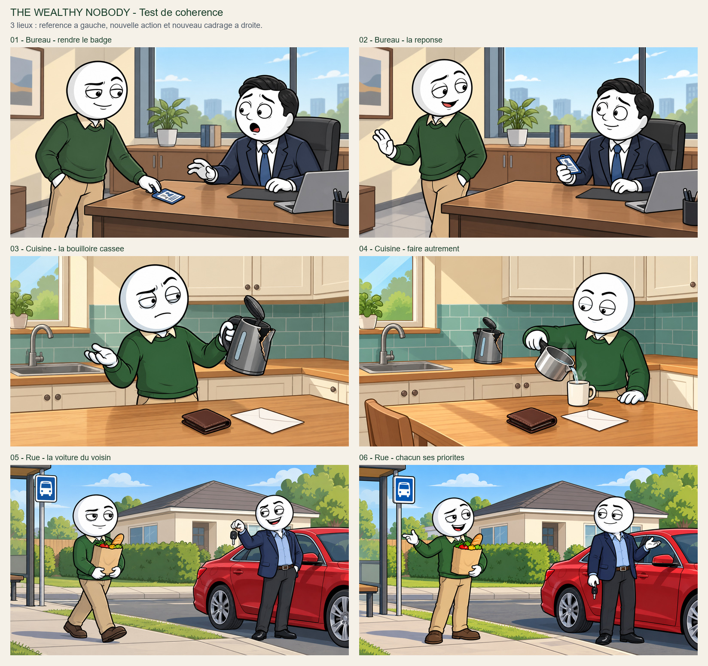

# The Wealthy Nobody — essai de continuite et de variete

Six images fixes pour verifier la mise en scene avant production de masse : trois lieux, un meme protagoniste en pull vert, deux secondaires distincts. Les trois images de gauche sont les scenes precedemment approuvees ; les trois images de droite sont de nouveaux essais a juger. Ces trois paires sont de courts beats fictifs de controle ; ce n’est pas un episode monte ni un script synchronise. Pas de voix, timings inventes, video complete, upload ou preset serveur modifie.

CLI configure sur le VPS, prompts manuels et references choisies par Codex. La geometrie, les acteurs et les objets sont inspectes apres reception ; les trois nouvelles sorties attendent le jugement utilisateur.

## Plans et controle visuel

| Plan | Lieu | Action | Inspection |
| --- | --- | --- | --- |
| [01](../original-2026-10-18/office.jpg) | bureau | Le protagoniste rend son badge, responsable surpris. | Scene de bureau deja approuvee, reutilisee comme ancre. Petit nez/oreilles du responsable deja documentes, sans extrapoler cette exception au protagoniste. |
| [02](bureau-reponse.jpg) | bureau | Le responsable recupere le badge ; protagoniste lui dit au revoir. | Deux identites et tenues reconnaissables ; un seul badge, maintenant dans la main du responsable. Fenetre, meuble bas, plante/livres et ordinateur gardent leurs positions relatives. Changement de camera faible : l’action et la pose changent davantage que l’angle. |
| [03](../original-2026-10-18/kitchen.jpg) | cuisine | La bouilloire est cassee, protagoniste contrarie. | Scene de cuisine deja approuvee, reutilisee comme ancre. Casse tres exageree de la bouilloire deja documentee. |
| [04](cuisine-alternative.jpg) | cuisine | Bouilloire cassee posee hors usage ; protagoniste utilise une petite casserole intacte pour son mug. | Meme pull vert et cuisine reconnaissable : fenetre/evier a gauche, carrelage vert, meubles creme. Bouilloire cassee posee sur plan arriere et une casserole intacte utilisee, mug ajoute pour l’action. Portefeuille et enveloppe conserves. Table vue davantage en diagonale avec un bord de chaise nouveau ; angle modere et proportions de bouilloire moins exagerees. |
| [05](../original-2026-10-18/outdoor.jpg) | rue | Le protagoniste porte ses courses, son voisin montre les cles de sa voiture. | Scene exterieure deja approuvee : protagoniste avec courses et voisin en veste bleue pres de la voiture rouge. |
| [06](rue-reponse.jpg) | rue | Le protagoniste indique l’arret de bus, voisin reagit avec amusement. | Memes deux acteurs/tenues, voiture rouge, abri de bus, maison et haie dans le meme ordre. Gestes et expressions changes ; sac soutenu d’une main, cles abaissees dans l’autre personnage. Camera tres proche de la reference : surtout nouvelle action et cadrage, pas une vue opposee ou une reconstruction 3D. |

## Prompts manuels et ordre reel des references

Les deux references de chaque plan sont l’ancre de lieu/personnages de cette paire, puis la fiche d’identite du protagoniste. La fiche de corps entier reste une reference derivee. Les fichiers natifs envoyes, SHA et recus sont conserves dans le travail prive ; les exports de consultation ne remplacent pas ces originaux.

### 02-office-response

Full-frame landscape 16:9 narrative cartoon film still for The Wealthy Nobody, NOT a thumbnail collage. Image 1 is the exact approved location and supporting character reference; image 2 is the exact main actor. Preserve their clean bold black outlines, attractive expressive round-white-head cartoon drawing, controlled matte colours and simple cel shadows. Main actor has bald perfectly round pure-white head, no nose/ears/hair, forest-green sweater with cream collar, tan trousers and brown shoes, compact adult build, not a long stick figure or child. All visible skin and hands pure white, simple attached hands, one copy of each actor and two arms each. Expressions respond to the action. Preserve supporting identity from image 1, do not turn him into a second green-sweater protagonist. Do NOT import navy suit/red tie mascot, villa, chef, casino or yacht. Same place from a meaningful moderate camera change, not an image mirror or newly invented set. No logos, generated words, captions or watermarks. NEXT BEAT immediately after image 1: the manager has accepted the badge. He remains seated on RIGHT in same navy suit, white shirt and blue tie, same black side-part hair and white cartoon face as reference, mild resigned understanding rather than shocked fear. He holds the SAME blue-framed employee badge in ONE white hand at desk height, looking at the green-sweater protagonist; his other hand rests on the black desk pad. Badge is NOT duplicated on the desk. Main actor remains on LEFT, now with both hands clear of desk, relaxed friendly small open-mouth goodbye, free hand making a modest low farewell gesture while turning his shoulders toward the room exit offscreen LEFT. Exactly TWO adults. CAMERA: eye-level medium lateral three-quarter view shifted to the protagonist's LEFT side, slightly closer toward the short end of the same wooden desk, so main actor is seen in near LEFT profile and manager's seated reaction in RIGHT three-quarter view. Keep the conversation axis, not a reverse crossing. Broad dark-framed window and low oak cabinet remain BEHIND manager, potted plant on cabinet LEFT of three books, simple framed landscape on LEFT wall. Grey laptop remains on desk RIGHT edge in front of manager with black desk pad just to its left and pen cup at far right, no new laptop on left, no extra chair or doors. Props must change projection appropriately with camera without moving to another wall. No readable employee name on badge; abstract marks only. Make actual new acting and perspective, not a crop of the reference.

References :

1. 01-office/scene-v1.png — Approved office anchor and exact manager identity: window, low cabinet, plant, books, desk, laptop, pen holder and badge. Preserve relative geometry and wardrobe, vary acting.

2. identity/hero-v1.png — Same inspected finance protagonist: bald perfectly round white head, forest-green sweater, cream shirt collar, tan trousers and dark-brown shoes. Change expression, not identity.

### 04-kitchen-workaround

Full-frame landscape 16:9 narrative cartoon film still for The Wealthy Nobody, NOT a thumbnail collage. Image 1 is the exact approved location and supporting character reference; image 2 is the exact main actor. Preserve their clean bold black outlines, attractive expressive round-white-head cartoon drawing, controlled matte colours and simple cel shadows. Main actor has bald perfectly round pure-white head, no nose/ears/hair, forest-green sweater with cream collar, tan trousers and brown shoes, compact adult build, not a long stick figure or child. All visible skin and hands pure white, simple attached hands, one copy of each actor and two arms each. Expressions respond to the action. Preserve supporting identity from image 1, do not turn him into a second green-sweater protagonist. Do NOT import navy suit/red tie mascot, villa, chef, casino or yacht. Same place from a meaningful moderate camera change, not an image mirror or newly invented set. No logos, generated words, captions or watermarks. LATER BEAT, in SAME modest home kitchen: instead of treating a broken appliance as a disaster, the main actor has placed the SAME visibly cracked grey electric kettle from image 1 upright on the BACK countertop RIGHT of the sink, UNPLUGGED, lid still open, never operating or pouring from it. The protagonist stands RIGHT of centre, smiling with quiet relief; he pours hot water from ONE separate small intact plain stainless stovetop pot with a black handle into ONE plain cream mug on the FOREGROUND oak table. One simple white hand grips the intact pot handle naturally, the other hand rests on the table away from hot water; no repairing instructions, sparks or boiling broken kettle. Add only the necessary intact pot and mug. Brown leather wallet remains flat near CENTRE of foreground table, white closed envelope remains to its RIGHT, neither is duplicated or disappears. Exactly ONE person; no partner invented, no chef, no indoor neighbours. CAMERA: eye-level medium-wide view from the LEFT end of the foreground table, diagonal along tabletop, showing more of its left edge and main actor in side three-quarter view on RIGHT. The large window and sink remain LEFT, sea-green rectangular tiled splashback on back wall, cream cupboards with round brown knobs above/right, oak countertop turns at RIGHT corner, no stove copied from other channel. All these are this reference kitchen under a modest angle shift, not a remodel; do not relocate window to right. Show sensible kettle proportions with same crack and same grey/black colours, but no magnified exploding appliance. Clean restrained graphic background, not painterly texture.

References :

1. 02-kitchen/scene-v1.png — Approved home kitchen anchor: left window/sink, sea-green tiled splashback, cream cupboards, oak countertops and foreground table with brown wallet and white envelope. Broken grey kettle is carried in first beat.

2. identity/hero-v1.png — Same inspected finance protagonist: bald perfectly round white head, forest-green sweater, cream shirt collar, tan trousers and dark-brown shoes. Change expression, not identity.

### 06-street-response

Full-frame landscape 16:9 narrative cartoon film still for The Wealthy Nobody, NOT a thumbnail collage. Image 1 is the exact approved location and supporting character reference; image 2 is the exact main actor. Preserve their clean bold black outlines, attractive expressive round-white-head cartoon drawing, controlled matte colours and simple cel shadows. Main actor has bald perfectly round pure-white head, no nose/ears/hair, forest-green sweater with cream collar, tan trousers and brown shoes, compact adult build, not a long stick figure or child. All visible skin and hands pure white, simple attached hands, one copy of each actor and two arms each. Expressions respond to the action. Preserve supporting identity from image 1, do not turn him into a second green-sweater protagonist. Do NOT import navy suit/red tie mascot, villa, chef, casino or yacht. Same place from a meaningful moderate camera change, not an image mirror or newly invented set. No logos, generated words, captions or watermarks. NEXT BEAT immediately after the reference street image: main actor has stopped walking on sidewalk at LEFT, same green sweater/tan trousers/brown shoes. He holds SAME brown grocery bag with baguette, green leaves, red tomato and yellow pepper in the crook of his LEFT arm, with that white hand visibly supporting its bottom. His free RIGHT white hand gestures lightly toward the SAME bus-stop sign at far LEFT, friendly amused open-mouth smile and one relaxed raised eyebrow, looking at his neighbour. The neighbour stays on RIGHT beside the SAME red four-door sedan, same bald round pure-white face, navy blazer with pale-blue open-collar shirt and charcoal trousers. He lowers the SAME black car key fob toward his side in ONE hand and gives a small good-natured amused shrug with the other, friendly closed-mouth smile, no scowl or panic. Exactly TWO distinct adults, no second main actor, no extra car or people. CAMERA: moderate oblique medium-wide view from a position near the LEFT bus shelter, looking diagonally along the sidewalk toward the pair and red sedan, enough to see main actor's side and neighbour in three-quarter rather than copying reference's front view. Preserve screen sides and road line: bus shelter and blue white-bus pictogram sign on LEFT, same beige single-storey bungalow with grey hipped roof and dark central door behind hedge, red sedan on RIGHT with same wheel/rim style and front pointing offscreen RIGHT. House door and windows stay in the same order, shelter does NOT teleport behind sedan. Keep stable midday sun and modest trees, no new towers, no backwards mirrored car. Groceries remain supported, not a shopping bag hanging from nothing. No generated signs except original simple bus pictogram, no text or logos.

References :

1. 03-outdoor/scene-v1.png — Approved street anchor and exact bald neighbour: navy blazer, pale-blue shirt, charcoal trousers, black shoes, red sedan. Left bus shelter, bungalow, hedge, sidewalk and car keep their relationships.

2. identity/hero-v1.png — Same inspected finance protagonist: bald perfectly round white head, forest-green sweater, cream shirt collar, tan trousers and dark-brown shoes. Change expression, not identity.
