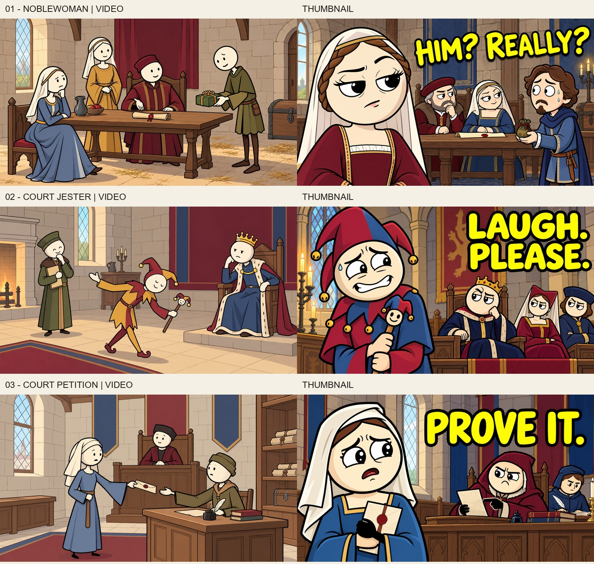
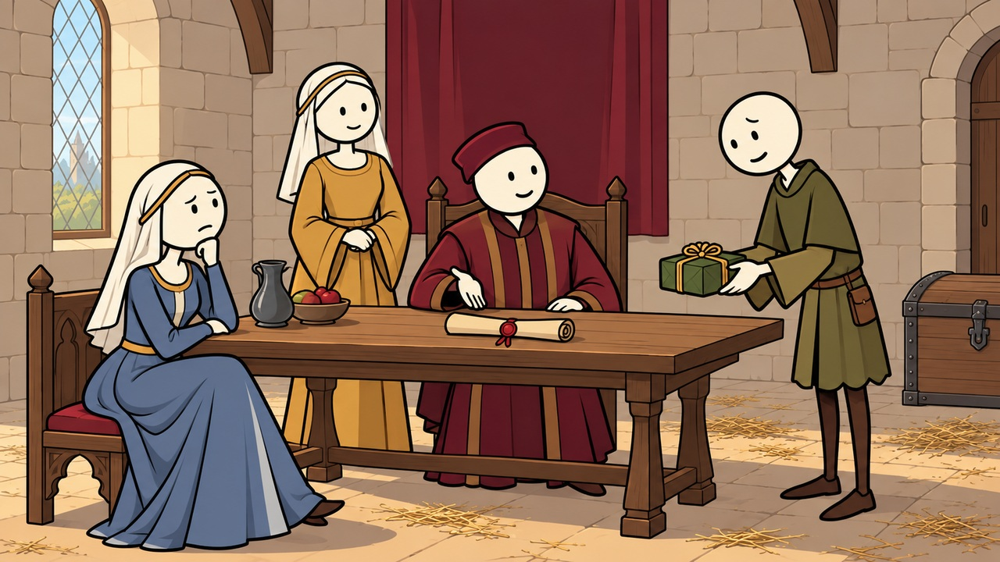
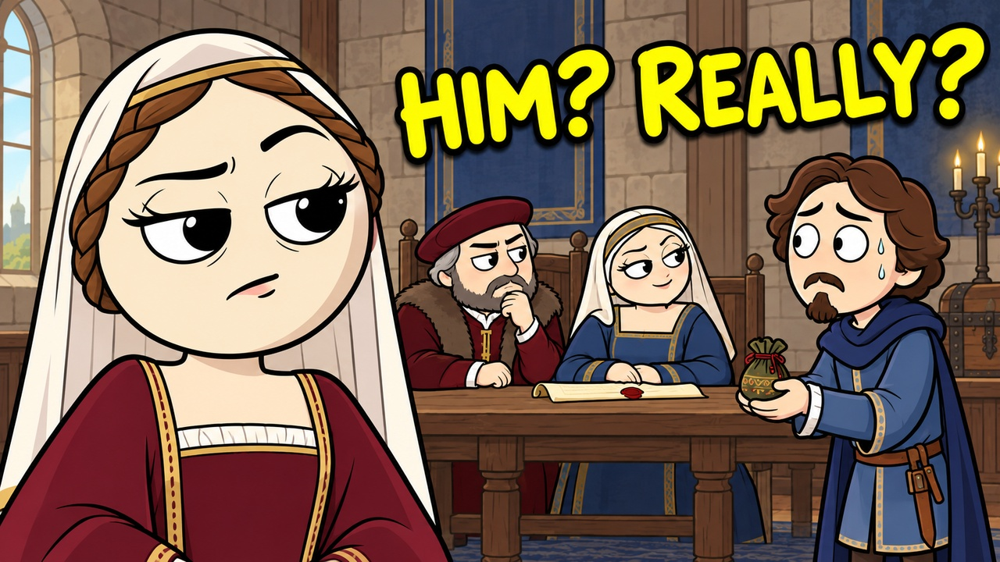
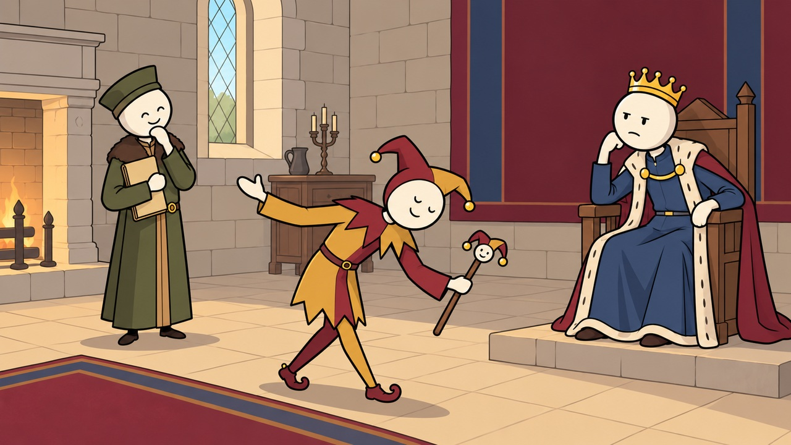
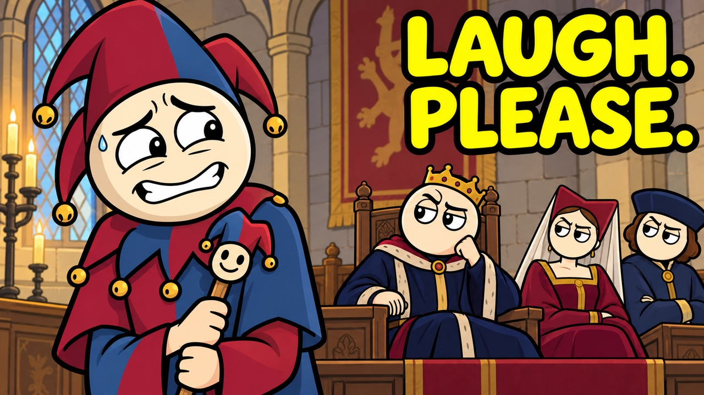
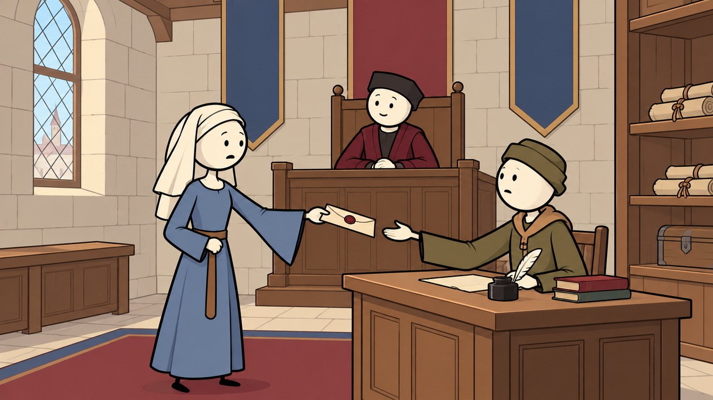
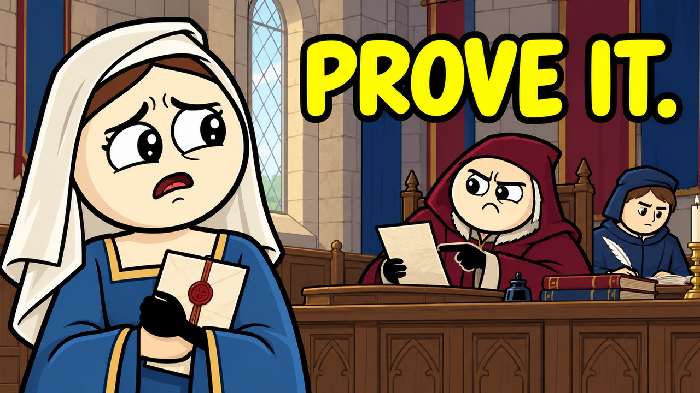

# Projet medieval — trois episodes et essais de style

15 octobre 2026. **Les trois sujets et la direction visuelle sont valides. Production autorisee et en cours.**

Ce projet est une nouvelle chaine anglophone, independante des cinq anciennes chaines historiques archivees. Le nom de chaine reste a choisir. Apres avoir valide les images, l'utilisateur confirme explicitement les trois sujets (« les trois go »). Il demande de conserver la voix Ryan Kurk. L'autorisation couvre maintenant les scripts, voix, images, montage et livraison. Voir [la fiche de production](PRODUCTION.md) pour les sources, les briefs et les identifiants TubeForge ; [audits des scripts](script-audits.json). Aucune publication YouTube n'est demandee.

## Ce que montre la reference

[Ottoman Days](https://www.youtube.com/channel/UCofDJBELO-cQNNcUb-mjZAg), releve Algrow/Nexlev du 15 octobre 2026 : huit videos. Les chiffres sont un instantane et ne prejugent pas des performances futures.

| Video | Vues observees | Publication |
| --- | ---: | --- |
| [Sultan's Daughter](https://www.youtube.com/watch?v=CTCTAW5o5Zk) | 302 502 | 1 octobre |
| [Sultan's Mother](https://www.youtube.com/watch?v=57nK03ZggRQ) | 51 660 | 6 octobre |
| [Sultan's Wife](https://www.youtube.com/watch?v=uwPFpNuVh5M) | 22 527 | 11 octobre |
| [Female Servant](https://www.youtube.com/watch?v=3oJhA5Y6QZ8) | 19 086 | 9 octobre |
| [Sultan's Doctor](https://www.youtube.com/watch?v=_QGM1JwPwiw) | 11 638 | 7 octobre |

Nexlev ne remonte que Daughter comme outlier au seuil de 1,5. **Hypothese editoriale : une place sociale precise, apparemment enviable, puis ses contraintes cachees.** C'est plus utile que de reduire toute la chaine a « le Moyen Age etait sale ». Echantillon petit, dates d'exposition differentes : aucune causalite prouvee entre sujet, miniature et vues.

Notre angle : **ce que ta famille, ton employeur ou les institutions pouvaient decider pour toi**, raconte a hauteur de personne, avec objets, choix, reactions et consequences concrets. Chaque episode fixe une region et une periode ; pas un Moyen Age universel de mille ans.

## Les trois premieres videos — ordre recommande

### 1. Why It Sucked to Be a Medieval Noblewoman

**France, principalement XIVe siecle. Miniature : HIM? REALLY?**

Promesse : ta famille negocie une alliance pendant que tu essaies de savoir qui tu vas epouser. Tu as du rang et des possessions, mais ton mariage engage beaucoup plus que tes sentiments.

Accroche de travail : *You have a fine dress, a family name, and a room full of people negotiating your future. Somehow, you are the quietest person at the table.*

Trajectoire a developper apres validation : proposition du pretendant → terres et liens familiaux → consentement religieux et pression familiale → obligations domestiques et transmission → marges de choix et d'action. Le conflit doit evoluer, pas empiler des malheurs.

La negociation matrimoniale est un point d'entree, pas toute la vie d'une noble. Genevieve Ribordy distingue le modele familial, dominant et politique/economique, d'un modele personnel de couples qui se marient sans l'accord parental. Ne pas dire « aucune femme ne pouvait refuser », ni confondre consentement canonique et liberte sociale totale. [Recherche, resume et references d'archives](https://journals.sagepub.com/doi/abs/10.1177/036319900102600301).

Miniature proposee : grande femme adulte sceptique a gauche, pretendant adulte nerveux offrant un petit present a droite, parents penches sur un parchemin. Demeure noble, robe bordeaux, voile de lin, bleu sourd. La plaisanterie vise l'absurdite du matchmaking familial.

### 2. Why It Sucked to Be the King's Jester

**Cour francaise, autour de 1400–1450. Miniature : LAUGH. PLEASE.**

Promesse : ton travail consiste a divertir des gens puissants, parfois en te moquant de leur monde. Savoir jusqu'ou aller et de qui depend ta place devient plus interessant qu'un simple concours de blagues.

Accroche de travail : *The room is full. Your patron is watching. You have just delivered your finest joke. Nobody laughs.*

Trajectoire : numero qui tombe a plat → apprentissage du public et du patronage → costume et place dans la maison → parole critique toleree → ecart entre acces aux puissants et autonomie reelle. Le personnage est un professionnel fictif ; aucune execution inventee pour une mauvaise plaisanterie.

Le Louvre situe au XIVe siecle l'institutionnalisation du fou de cour et sa parole ironique ou critique acceptee. Il documente aussi ses attributs : marotte, vetement mi-parti, capuchon et grelots. Cette latitude n'est pas une immunite juridique generale. [Figures du fou, Louvre](https://www.louvre.fr/expositions-et-evenements/expositions/figures-du-fou).

Miniature proposee : grand visage du bouffon avec sourire force a gauche, patron royal impassible a droite, deux reactions de courtisans. Le texte raconte le besoin de convaincre son public, sans inventer une condamnation a mort.

### 3. What Happened When a Medieval Woman Reported Rape?

**France de la fin du Moyen Age ; juridiction et dossier precis a fixer avec le script. Miniature : PROVE IT.**

Promesse : quitter la scene du crime ne termine pas l'histoire. Qui recueille la plainte ? Quels temoignages sont conserves ? Comment l'institution examine-t-elle l'affaire, et que permettent vraiment les sources de savoir ?

Accroche de travail : *The assault is over. Now you must decide whether to make a complaint—and discover whose version of the story the court will preserve.*

Trajectoire : decision de porter plainte → enquete et temoignages → contestation et reputation → issue documentee et limites de la justice → ce que les archives taisent. Les scenes montrent l'apres, les documents et les rapports de pouvoir, sans reenactment d'agression. Aucun humour aux depens de la victime.

Ce titre interrogatif remplace l'affirmation trop generale « reporting was always dangerous ». Des poursuites et des condamnations existaient ; leurs procedures et leurs effets variaient. Le chapitre de Gwen Seabourne expose cette diversite, mais son exemple ouvert est ANGLAIS et ne doit pas devenir une regle francaise. [Rape and Law in Medieval Western Europe](https://www.cambridge.org/core/books/abs/companion-to-crime-and-deviance-in-the-middle-ages/rape-and-law-in-medieval-western-europe/456E800DCA0EE9F051BDA59F6A828CF5).

Sara McDougall et David Perry montrent aussi combien le film *The Last Duel* simplifie les institutions et attribue des paroles qu'on ne possede pas dans les sources. Ne pas transformer ce film en preuve historique. [Analyse par les historiens](https://www.historynewsnetwork.org/article/fact-and-fiction-in-the-last-duel). Une autre piste francaise a examiner est l'enquete dijonnaise de 1472 etudiee dans *Justice for Jehanne* ; cette enquete ne doit pas etre fusionnee avec la France de 1386. [Presentation de l'entretien avec Sara McDougall](https://www.historicallythinking.org/p/justice-for-jehanne).

Miniature proposee : adulte en voile de lin tenant sa requete, grand visage calme et incredule a gauche ; officier et greffier au document a droite. « PROVE IT. » est une accroche editoriale, pas une citation d'archive. Le test visuel c.1380 est une scene composite de depot de petition, pas la reconstitution d'une affaire reelle.

## Style propose pour les VIDEOS

Huit vraies captures ont ete extraites de deux videos, pas seulement de leurs miniatures : Daughter a 00:03, 00:12, 00:24, 00:36 ; Mother a 01:32, 01:40, 01:50, 01:57. Les references completes et leurs empreintes restent dans le dossier de travail prive. Les miniatures et les images de video ont volontairement deux niveaux d'expressivite differents.

Videos : tetes rondes ivoire, yeux points, petites bouches, corps et membres etroits sous des vetements couverts, petits gestes lisibles. Palette sable/ocre, bordeaux, bleu sourd, olive ; contours nets et aplats mats. Architecture francaise credible et lisible, sans grandes tours ajoutees a l'horizon. Pas d'anatomie de super-heros.

Trois premiers essais ont ete regardes puis corriges : trop de fleurs de lys, de textures et de modeles de vetements. Les trois propositions montrees ici sont la **seconde passe**, personnellement regardee par l'agent visuel et par Codex principal. Elles restent un peu plus modelees que les plans les plus simples de la reference ; elles proposent un langage proche, pas une identite parfaite.

Les jpg fournis sont en 1280×720, exactement 16:9, generes depuis les originaux sur le VPS. Les originaux natifs sont conserves dans le travail prive. Ces trois tests ne prouvent pas encore la coherence d'un film entier : apres validation il faudra creer les fiches de personnages et les maitres de chaque lieu, puis verifier chaque image produite. Une nouvelle action ou un nouvel objet apporte une information ; le simple recyclage d'un tableau ne suffit pas.

## Style propose pour les MINIATURES

Visages humains cartoon adultes tres expressifs, grand visage au premier plan a gauche, scene secondaire a droite, contraste comique clair, texte jaune borde de noir lisible en petit. Les vrais thumbnails Daughter et Doctor sont envoyes comme references de dessin/composition ; vetements, visages et decors sont recrées pour la France medievale. Le texte doit ajouter le conflit au titre, pas le repeter.

Les trois images constituent des tests de direction, soumis a validation. La seconde passe simplifie les visages et reduit la broderie royale de la premiere ; le cadrage et les textes sont conserves. Le texte du sujet judiciaire doit rester sobre ; les autres peuvent utiliser une reaction comique. Pas de personnages historiques identifiables, de logos ou de scene sexuelle explicite. Le visage de la plaignante reste inquiet, plutot que totalement calme comme demande dans le prompt : constat visuel accepte pour cet essai, pas une affirmation sur une personne historique.

## Reprise apres la reponse utilisateur

**Confirmation acquise : les trois sujets et le style sont approuves.** Continuer leur production sans redemander la meme autorisation. Narration Ryan Kurk uniquement. Garder les inspections deleguees a Codex explicites et ne pas les presenter comme des clics humains.

Ensuite : recherche complementaire par episode → script original et controle des faits → voix → transcription et timings → decoupage avec narration, lieu et personnages nommes → references personnages et lieux approuvees → images controlees → montage et rendu sur VPS. Aucun rendu video sur le PC. Conserver les references effectivement envoyees, pas seulement leur intention dans un prompt.

Prompts exacts des tests et ordre des references : [manifest de validation](validation-prompts.json). Les modeles, acces et recus techniques restent prives. Aucune modification du frontend ni relance d'anciens projets n'est necessaire pour cette validation.
