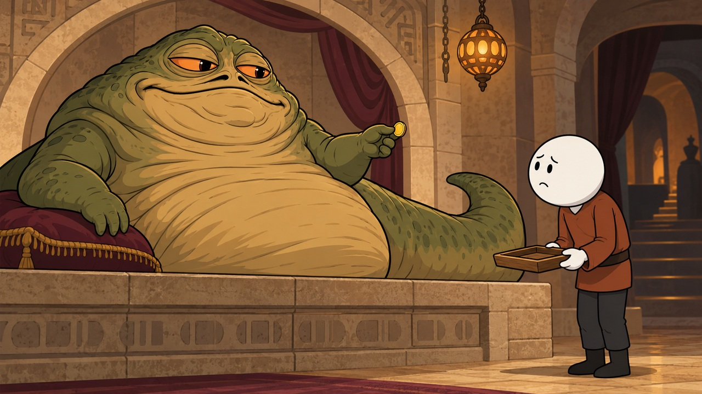

# Approved house illustration style

User decision, 15 October 2026: the Jabba palace test is approved, especially the
human employee on the right. Use that actual image as the primary drawing-style
anchor for every new white round-headed cast on Oddly Fictional Lives.



This approval supersedes earlier proposed styles and the stricter no-eyebrow
wording from earlier episodes. It does not approve every subsequent generated
image or prove consistency across a whole video.

## Human character language

- Smooth round white head, black oval/dot eyes, small mouth and restrained
  expressive eyebrows as drawn in the approved employee. No human nose, ears,
  hair, beard or realistic face unless a later explicit character decision says so.
- Compact clothed ADULT body. The approved ordinary employee reads at roughly
  3–3.5 head diameters tall including boots. This is a visual comparison guide,
  not an instruction to shrink every species or suit to one rigid anatomy.
- White simplified mitten hands, few clean finger marks, no realistic hands.
  Keep head and hands white together. The warm scene lighting in the approved
  source is accepted; do not turn it into beige human skin or heavily shaded skin.
- Clear clothing silhouette, modest simple folds, rounded shoes/boots. Wardrobe
  belongs to the episode: do not copy the rust tunic into every franchise.
- Expressions come from the small face, head tilt, shoulders and hands. Avoid
  expressionless lineups, enormous exaggerated emoji faces or permanent panic.
- User correction, 16 October: approval of a head design does NOT approve its
  reference expression as a permanent mood. Individual identity sheets use a
  calm neutral resting face. Every shot specifies the emotion of EACH visible
  named actor from the actual event: joy, amusement, confidence, concentration,
  frustration, surprise, fear or relief as appropriate. A happy event merits a
  visible smile; danger alone does not make every bystander wear the same face.
  Identity references lock anatomy, proportions and wardrobe, never acting.
  Inspect faces against the authored emotional beat, not only the cast sheet.
- Bulky armour may add silhouette width while the visible face remains the same
  simple round white drawing. Never replace it with a realistic muscular human.

## Drawing and composition

Bold black silhouette contours with finer interior lines; matte restrained
colours; simple shadows on clothes and objects; readable illustrated architecture.
Keep useful detail without photographic grunge, glossy 3D materials or extreme
depth. The focal interaction must be visible at phone size.

Match the rendering language, NOT the same warm palette, sandstone palace,
curtains or left-boss/right-worker layout in every scene. Halo needs its alien
ship structures and Space Marines need their own armour/environment design.

Stage a readable action and reaction. A new image must carry something new from
the narration. The location stays coherent within its scene, using its own master
and a fixed established camera side. No random reversed rooms to create variety.
Keep authored meaningful close shots; do not substitute animated zooms for events.

## Alien exception

Jabba retains his green slug body, broad face, heavy eyes, short arms and tail.
Covenant aliens retain species-defining anatomy, colours and equipment. They are
drawn with the SAME linework/matte illustration language, but are not humans in
alien suits or compulsory white circular heads. A Grunt does not become a Prophet
through promotion. Alien cast gets individual references just like human cast.

## Reference roles before any new episode

1. Actually view the approved palace image for house rendering/proportions.
2. Create and inspect a new individually named cast sheet per recurring actor,
   matching the house style but the correct episode outfit/species.
3. Create and inspect the relevant empty location masters independently.
4. Send those actual references with explicit roles in every authored shot.
   The house image supplies drawing style only: never bring Jabba, palace walls,
   worker, tray or coin into another setting by accident.
5. Record exact ordered inputs and inspect the generated output, comparing cast,
   proportions, action, scene geography and the approved house rendering.

The working trials under `visual-tests/` are kept separate from the approved
palace reference. An isolated neutral worker sheet is a candidate translation
of the approved style, not automatic approval of a new mascot or all costumes.

The corrected, actually inspected [neutral identity sheet](visual-tests/white-head-neutral-2026-10-16.jpg)
replaces the earlier worried worker sheet as the resting-face guide. It preserves
the approved drawing and compact proportions. Its rust outfit belongs to this
episode only; new universes still get appropriate wardrobe. Neither a neutral
sheet nor the palace reference freezes the actor's expression in story images.

## Reusable prompt block

```text
Use the approved house-style image for DRAWING LANGUAGE ONLY: bold clean black
outlines, matte controlled colours, clear simple shadows, readable illustrated
backgrounds and compact expressive adult cartoon characters. Human characters
have large smooth ROUND WHITE heads, small black oval/dot eyes, tiny mouths,
restrained expressive eyebrows and simple WHITE mitten hands, with the same
proportions as the approved human employee. No realistic human faces, stretched
bodies, detailed fingers or glossy 3D rendering. Use this episode's separate
cast sheets for identities, outfits and species anatomy, and its location master
for the actual environment. Do not import people, props, palace architecture,
palette or composition from the house-style image. Recognisable nonhuman aliens
keep their own anatomy and natural colours in the same matte2D drawing technique.
Show exactly the named actors, one of each, performing the one specified event.
Identity sheets supply head design, body and wardrobe ONLY, never a fixed mood.
Follow the separately authored expression and body language for EACH actor in
this exact shot. Relaxed/happy moments must not inherit the worried expression
of an earlier reference. Retain the simple face design while changing its acting.
Full-frame16:9; no panels, text, watermark or blurred side borders.
```

The block is a reusable constraint, not a complete scene prompt or evidence that
an image passed visual review. It does not trigger generation by itself.
