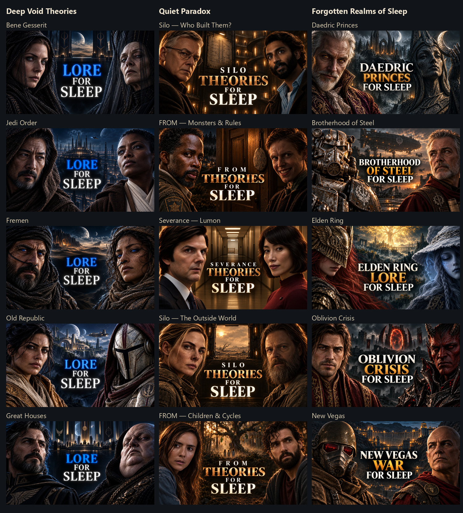

# 15 miniatures sleep — 22 octobre 2026

Cinq miniatures par chaîne, dans l’ordre des quinze scripts. Les JPG sont prêts à importer : **1280 × 720**, chacun sous **2 Mo**. Les originaux PNG sont conservés.

Chaque dossier vidéo contient MINIATURE.jpg, ORIGINAL.png, TITRE.txt et PROMPT.txt. Ouvrir APERCU.html pour voir les images et leurs titres.

DA conservées : Deep Void bleu nuit/noir et LORE bleu ; Quiet Paradox brun/ambre et THEORIES bronze ; Forgotten Realms direction A cinéma réaliste, ivoire/ambre.

Les deux miniatures Star Wars utilisent des personnages originaux représentatifs. Les premières compositions avec héros nommés ont été refusées par le générateur intégré, sans motif détaillé. Les versions finales ne représentent pas Yoda/Obi-Wan ni Revan/Bastila.

Les images sont des illustrations éditoriales originales, pas des captures officielles ni des reconstitutions exactes. Les exports ont été regardés et comparés aux références. Ils restent des propositions à choisir par l’utilisateur ; aucune publication ou approbation utilisateur n’est enregistrée.

## Deep Void Theories

1. [The Secrets of the Bene Gesserit Explained to Fall Asleep To | Dune Lore](Deep%20Void%20Theories/DV-08-bene-gesserit/MINIATURE.jpg)
2. [The Rise and Fall of the Jedi Order Explained to Fall Asleep To | Star Wars Lore](Deep%20Void%20Theories/DV-09-jedi-order/MINIATURE.jpg)
3. [The Entire History of the Fremen Explained to Fall Asleep To | Dune Lore](Deep%20Void%20Theories/DV-10-fremen/MINIATURE.jpg)
4. [The Entire History of the Old Republic to Fall Asleep To | Star Wars Legends](Deep%20Void%20Theories/DV-11-old-republic/MINIATURE.jpg)
5. [The Great Houses of Dune Explained to Fall Asleep To | Dune Lore](Deep%20Void%20Theories/DV-12-great-houses/MINIATURE.jpg)

## Quiet Paradox

1. [Who Built the Silos — and Why? | Silo Theories to Fall Asleep To](Quiet%20Paradox/QP-07-silo-builders/MINIATURE.jpg)
2. [The Monsters, Talismans & Rules of FROM Explained to Fall Asleep To](Quiet%20Paradox/QP-08-from-rules/MINIATURE.jpg)
3. [What Is Lumon Really Building? | Severance Theories to Fall Asleep To](Quiet%20Paradox/QP-09-lumon-building/MINIATURE.jpg)
4. [The World Outside the Silos | Mysteries & Theories to Fall Asleep To](Quiet%20Paradox/QP-10-silo-outside/MINIATURE.jpg)
5. [The Children, the Trees & the Cycles of FROM | Theories to Fall Asleep To](Quiet%20Paradox/QP-11-from-cycles/MINIATURE.jpg)

## Forgotten Realms of Sleep

1. [The Daedric Princes Explained to Fall Asleep To | Elder Scrolls Lore](Forgotten%20Realms%20of%20Sleep/FR-04-daedric-princes/MINIATURE.jpg)
2. [The Entire History of the Brotherhood of Steel to Fall Asleep To | Fallout Lore](Forgotten%20Realms%20of%20Sleep/FR-05-brotherhood/MINIATURE.jpg)
3. [The Story of Elden Ring Explained to Fall Asleep To](Forgotten%20Realms%20of%20Sleep/FR-06-elden-ring/MINIATURE.jpg)
4. [The Oblivion Crisis Explained to Fall Asleep To | Elder Scrolls Lore](Forgotten%20Realms%20of%20Sleep/FR-07-oblivion-crisis/MINIATURE.jpg)
5. [The War for New Vegas Explained to Fall Asleep To | Fallout Lore](Forgotten%20Realms%20of%20Sleep/FR-08-new-vegas/MINIATURE.jpg)

## Reprise

Générations et retouches : outil image intégré. Prompts effectifs et références ordonnées/empreintes dans prompts.json ; vérification et mesures dans review.json. Aucun autre fournisseur utilisé pour ce lot.

Corrections effectuées : T-60 et casque NCR depuis références des jeux ; incendies de fond et pendentif incorrect retirés sur Oblivion ; tour hors sol supprimée sur Silo ; gravure du talisman FROM corrigée depuis une capture d’épisode. Les accessoires restent des interprétations éditoriales.

Références de tiers conservées dans le dossier de travail privé, pas redistribuées dans ce paquet. Sources listées dans sources-references.json. Anciennes miniatures et essais préservés.

Aucune voix, vidéo ou programmation nouvelle lancée par cette commande.
